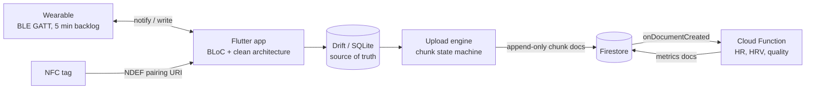

# PPG BLE Sync (ble_prototype)

Offline-first Flutter app (iOS + Android) that streams PPG (photoplethysmography) data from a BLE
wearable, stores it in a local SQLite database (Drift), backfills gaps from the wearable's on-board
history, and uploads 10-second chunks to Firestore, where a Cloud Function computes heart rate, HRV and
signal quality. It showcases BLoC on a feature-first clean architecture. There is no real hardware: a
byte-accurate `FakePpgDevice` simulates the wearable, and an NFC fake simulates tap-to-pair.

## 📐 System design

**→ [docs/ARCHITECTURE.md](docs/ARCHITECTURE.md)** — the system-design write-up: requirements,
back-of-envelope numbers, component and layer diagrams, sequence diagrams (live stream, reconnect +
history resync, cloud upload, NFC pairing), the chunk state machine, reliability/idempotency, failure
modes, trade-offs with the alternatives considered, scaling, and known limitations.



Other docs:

- [docs/BLE_NFC_PRIMER.md](docs/BLE_NFC_PRIMER.md) — BLE & NFC concepts (GATT, CCCD, MTU, NDEF, …)
  mapped to the code, plus our placeholder PPG protocol.
- [docs/SPEC.md](docs/SPEC.md) — agreed scope. [functions/README.md](functions/README.md) — backend and
  Firestore schema.

## Quick start (fake device, no hardware, no Firebase)

```sh
flutter pub get
flutter run --dart-define=ENABLE_FIREBASE=false      # any simulator/emulator/device
```

Defaults use the fake wearable and fake NFC reader, so it runs on the iOS Simulator and Android
emulator. Then:

1. **Device** tab → **Scan** → **Connect** on `PPG-Fake-0001` (or **Tap to pair**: the fake NFC reader
   "reads" the fake sensor's tag after 1.5 s and connects).
2. **Live** tab → waveform (last 5 s) → **Record** / **Stop**. **Sync history** backfills gaps from the
   device backlog manually (it also runs automatically after every reconnect).
3. **Sessions** tab → recorded sessions and chunk sync counts; **Sync now** uploads (needs Firebase,
   see below).

### Debug fault panel

On the **Device** tab, expand **Debug fault panel (fake device)** (only shown with the fake device):

| Control | Effect | What to observe |
|---------|--------|-----------------|
| **Drop link** | Simulates a link loss | Reconnect with backoff (1 s, 2 s, 4 s … max 30 s), then history resync |
| **Outage 10 s** | Device unreachable for 10 s | Several reconnect attempts; the device keeps buffering; gap backfilled afterwards |
| **Drop 20 packets** | Skips 20 live notifications (they stay in the backlog) | Live gap detected after 1 s → targeted history download |
| **Phone Bluetooth on** | Toggles the (simulated) adapter | Bluetooth-off UI in the permission gate |
| **Device on charger** | Charging flag on the status characteristic | Status card |
| **Packet loss** slider (0–50 %) | Random dropped notifications | Gaps + backfill |
| **Random drops / min** slider (0–6) | Random disconnects | Reconnect loop under stress |
| **Heart rate** slider | Pulse rate of the synthetic signal | Waveform and, in the cloud, `avgHeartRateBpm` |

## Dart-defines

| Define | Default | Meaning |
|--------|---------|---------|
| `USE_FAKE_DEVICE` | `true` | `FakePpgDevice` + fake permissions. `false` = real BLE via `flutter_reactive_ble` + `permission_handler` |
| `USE_FAKE_NFC` | `true` | `FakeNfcReader`. `false` = real reader via `nfc_manager` |
| `ENABLE_FIREBASE` | `true` | `false` = no Firebase at all (uploads disabled, app fully offline) |
| `USE_EMULATOR` | `false` | Point Auth/Firestore at local emulators (Auth 9099, Firestore 8080, Functions 5001) |
| `EMULATOR_HOST` | `localhost` | Emulator host; on a physical device use your machine's LAN IP |

Note: `lib/firebase_options.dart` is a **stub** for the demo project `demo-ppg` that only works with
the emulators. With the default `ENABLE_FIREBASE=true` and no emulator, uploads fail and chunks end in
`failed` — use `USE_EMULATOR=true`, `ENABLE_FIREBASE=false`, or configure a real project.

## Firebase emulators

Requirements: Node 20+, firebase-tools 15+, and **Java 21+** for the Firestore emulator. On macOS:
`brew install openjdk@21` (keg-only) and prefix commands with
`PATH=/opt/homebrew/opt/openjdk@21/bin:$PATH`.

```sh
cd functions && npm install
PATH=/opt/homebrew/opt/openjdk@21/bin:$PATH npm run serve      # emulators + UI at http://127.0.0.1:4000
# in another terminal, from the repo root:
flutter run --dart-define=USE_EMULATOR=true                     # iOS Simulator / Android emulator
```

- The Android emulator reaches the host via `10.0.2.2`; FlutterFire maps `localhost` automatically, and
  `android/app/src/main/res/xml/network_security_config.xml` allows cleartext only to
  `10.0.2.2`/`localhost`/`127.0.0.1`.
- Physical device: set `"host": "0.0.0.0"` for the emulators in `firebase.json`, run with
  `--dart-define=EMULATOR_HOST=<your LAN IP>`, and add that IP to the network security config.
- Record a session, stop it, open the Emulator UI → Firestore → `users/{uid}/sessions/…/chunks` and
  `…/metrics` (written by `analyzeChunkOnCreate`).

## Real Firebase project

```sh
dart pub global activate flutterfire_cli
flutterfire configure                 # overwrites lib/firebase_options.dart
firebase use <your-project-id>
firebase deploy --only firestore:rules,firestore:indexes,functions
```

Enable **Anonymous** sign-in in the Firebase console (Authentication → Sign-in method), then
`flutter run` (without `USE_EMULATOR`). Cloud Functions deploys need the Blaze plan.

## Real devices and hardware

```sh
flutter run --dart-define=USE_FAKE_DEVICE=false --dart-define=USE_FAKE_NFC=false
flutter build apk --debug
flutter build ios --no-codesign --debug
```

- The GATT protocol (UUIDs, frame layout) is a **placeholder** isolated in
  `lib/features/device_connection/data/protocol/ppg_packet_codec.dart`; real hardware needs a matching
  firmware or a new codec.
- Android: min SDK 24; runtime "Nearby devices" permission on 12+, location on ≤ 11.
- iOS: deployment target 15.0. Run `cd ios && pod install --repo-update` once if CocoaPods specs are
  stale.

### iOS NFC caveat

- Reading NFC tags requires the **NFC Tag Reading** capability
  (`ios/Runner/Runner.entitlements`, `com.apple.developer.nfc.readersession.formats = [TAG]`), which is
  only available with a **paid Apple Developer account**. With a free account, remove the entitlement
  (or keep `USE_FAKE_NFC=true`) to sign the app. The simulator has no NFC: use the fake reader.
- iOS never exposes BLE MAC addresses (it uses per-phone CoreBluetooth UUIDs). A tag carrying a MAC is
  resolved by scanning for the PPG service and matching the advertised name (contains the last two MAC
  bytes) or the only PPG device in range. Writing the device's name on the tag helps.
- Tag format: an NDEF URI record `ppgsync://pair?id=AA:BB:CC:DD:EE:FF&name=PPG-Sensor` (any NFC
  writer app can create it; details in the primer).

## Code generation

Drift code is generated into `*.g.dart` files (already present). After changing tables:

```sh
dart run build_runner build --force-jit
```

`--force-jit` is required: the default AOT-compiled build script fails with this toolchain.
`drift_dev` is pinned `< 2.32.1` for `meta` compatibility.

## Testing

```sh
flutter analyze
flutter test                                   # unit, bloc, Drift in-memory, widget, integration (fake device)

cd functions
npm test                                       # backend unit tests (chunk decoding, HR/HRV/quality)
PATH=/opt/homebrew/opt/openjdk@21/bin:$PATH npm run test:emulators   # Firestore rules + trigger e2e
PATH=/opt/homebrew/opt/openjdk@21/bin:$PATH npm run test:flutter-e2e # Flutter upload engine → emulators
```

`test_emulator/` (the Flutter ↔ emulator E2E) lives outside `test/`, so plain `flutter test` doesn't
need emulators.

## Project structure

```text
lib/
  main.dart                     bootstrap: Firebase, HydratedStorage, DI, runApp
  app/app.dart                  MultiBlocProvider wiring, Device / Live / Sessions tabs
  core/                         Failure + Result, AppConfig (dart-defines), get_it DI, Drift AppDatabase,
                                batcher, Firebase bootstrap, theme, BlocObserver
  features/
    device_connection/          permissions, scan/connect/reconnect, codec, real + fake BLE adapter, fault panel
    ppg_recording/              live waveform, batched recording into Drift, sessions list
    device_sync/                history download / resume by sequence number
    cloud_sync/                 chunk encoder, upload engine with retry/backoff, pruning, Firestore remote
    pairing_nfc/                NDEF codec, nfc_manager + fake reader, PairingBloc (HydratedBloc)
test/                           mirrors lib/ (+ helpers: in-memory DB, packet builders, fake cloud remote)
test_emulator/                  Flutter E2E against the Firebase emulators
functions/                      Cloud Functions (TypeScript): analyzeChunkOnCreate + unit/emulator tests
firestore.rules, firestore.indexes.json, firebase.json, .firebaserc
docs/                           ARCHITECTURE.md, BLE_NFC_PRIMER.md, SPEC.md, HANDOFF.md
```
