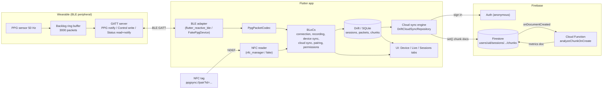
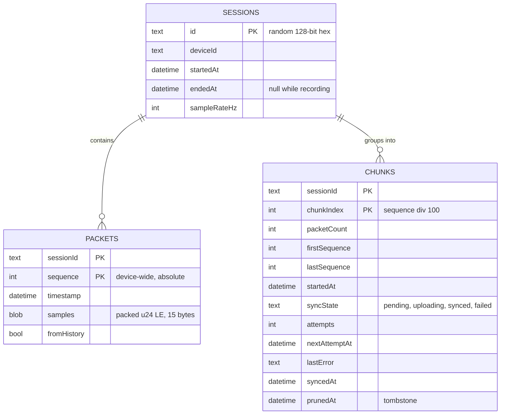
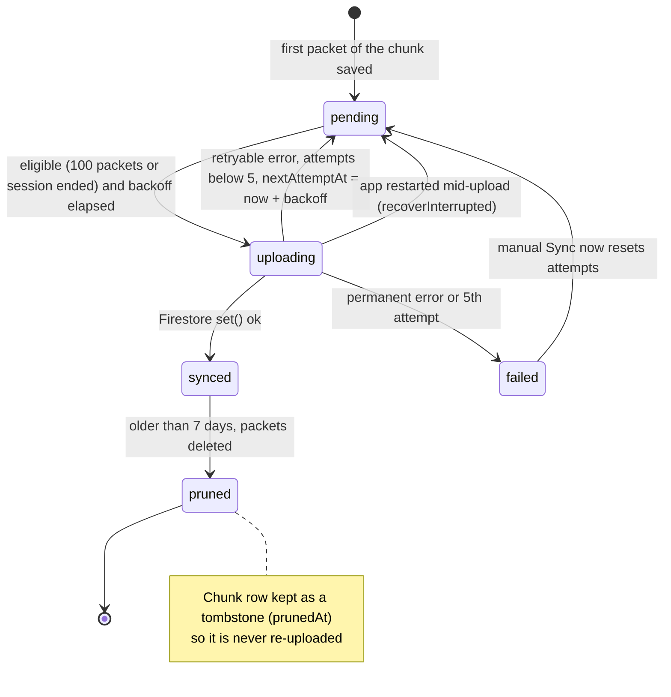
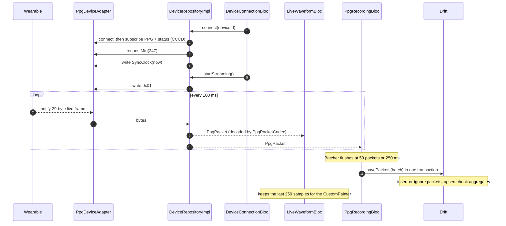
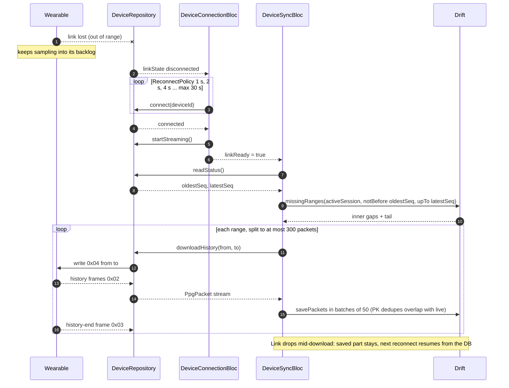
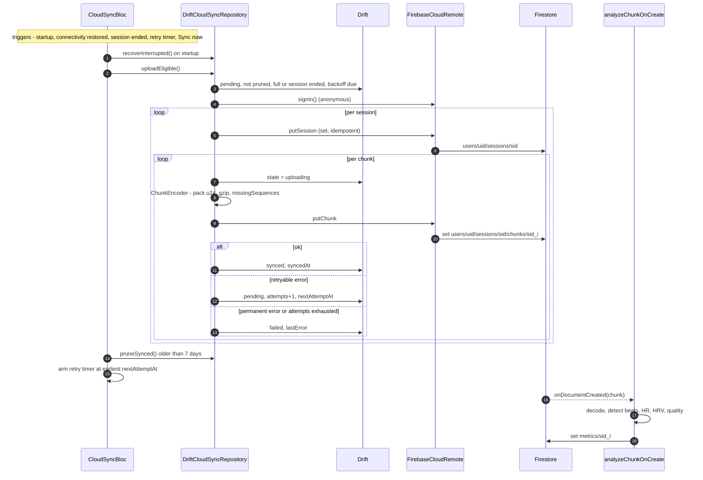
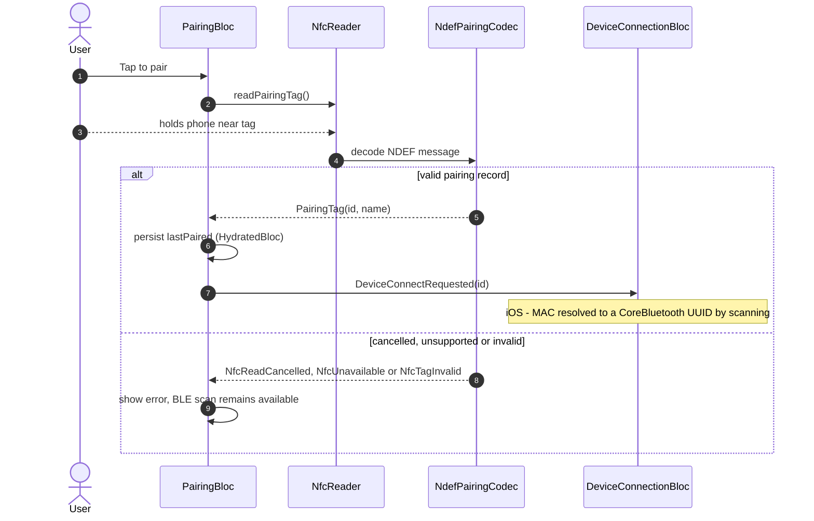

# System design: PPG BLE Sync

This document presents the app the way you would in a system-design interview: requirements first,
then the high-level design, the data model and the numbers, the critical flows, reliability, failure
modes, and finally the trade-offs and what we would change at scale. Every component named here exists
in the code; file paths are given so you can check.

For the radio/NFC concepts (GATT, MTU, CCCD, NDEF …) read [BLE_NFC_PRIMER.md](BLE_NFC_PRIMER.md).
The agreed scope lives in [SPEC.md](SPEC.md).

Contents

1. [Problem & requirements](#1-problem--requirements)
2. [Back-of-envelope numbers](#2-back-of-envelope-numbers)
3. [High-level architecture](#3-high-level-architecture)
4. [App layering (clean architecture + BLoC)](#4-app-layering-clean-architecture--bloc)
5. [Data model](#5-data-model)
6. [Key flows](#6-key-flows)
7. [Reliability & idempotency](#7-reliability--idempotency)
8. [Failure modes](#8-failure-modes)
9. [Trade-offs and alternatives considered](#9-trade-offs-and-alternatives-considered)
10. [Scaling & evolution](#10-scaling--evolution)
11. [Known limitations](#11-known-limitations)

---

## 1. Problem & requirements

> "Design a mobile app that collects photoplethysmography (PPG) data from a Bluetooth wearable, never
> loses data when the phone or network is flaky, and gets it to the cloud where heart-rate metrics are
> computed."

### Functional

- Discover a wearable by BLE scan **or** by tapping an NFC tag; connect; show battery/status.
- Show a live waveform of the PPG signal.
- Record sessions: persist every packet locally.
- After a disconnect, **backfill** packets the wearable stored while the phone was away.
- Upload recorded data to the cloud; the backend computes avg heart rate, HRV and signal quality per
  10 s chunk.
- Remember the last paired device; reconnect automatically after link loss.

### Non-functional

| Requirement | How it is met |
|-------------|---------------|
| **No data loss** across link drops, app crashes, offline periods | Device backlog + sequence numbers + local DB as source of truth + resumable uploads |
| **Offline-first** — the app is fully usable without network | Drift (SQLite) is the source of truth; cloud is a background replica |
| **Idempotent** sync (retries, duplicates, crash mid-upload) | Deterministic keys: `(sessionId, sequence)` locally, `sessionId_chunkIndex` in Firestore; append-only rules |
| **Battery/radio friendly** | Notifications (not indications), batched DB writes, capped backoff, bounded scans |
| **Testable without hardware** | `FakePpgDevice` and `FakeNfcReader` behind the same ports as the real adapters; emulator-first backend |
| **Security** | Anonymous Auth; Firestore rules restrict every user to `users/{uid}/**` and validate the schema |
| **Out of scope** | Real device protocol (placeholder), background execution, multi-device accounts, UI polish |

---

## 2. Back-of-envelope numbers

Constants come from the code: 50 Hz sampling and 5 samples/packet (`PpgPacketCodec.sampleRateHz`,
`samplesPerPacket`), 24-bit samples, 100 packets/chunk (`AppDatabase.packetsPerChunk`), device backlog
3000 packets (`FakePpgDevice.backlogCapacity`).

| Quantity | Calculation | Value |
|----------|-------------|-------|
| Packets per second | 50 Hz ÷ 5 | **10 /s** |
| BLE frame size | 14 B header + 5 × 3 B | **29 B** (needs MTU > 23 → we request 247) |
| BLE payload rate | 10 × 29 B | **290 B/s ≈ 2.3 kbit/s** (a few % of even a BLE 4.x link) |
| Raw sample data | 50 × 3 B | 150 B/s → **540 KB/hour**, ~13 MB/day |
| Packets per hour | 10 × 3600 | **36,000** |
| Local DB per hour (estimate) | ~140 B/row incl. text timestamp, 32-char session id and PK index | **~5 MB/hour**, ~120 MB/day |
| Chunk duration | 100 packets ÷ 10/s | **10 s** (500 samples) |
| Chunks per hour | 3600 ÷ 10 | **360** (8,640/day) |
| Chunk doc size | 1,500 B packed → gzip ≈ 1.4 KB (measured on a synthetic PPG-like signal) + ~300 B of fields | **≈ 2 KB** vs Firestore's **1 MiB** limit (rules cap the blob at 512 KiB) |
| Firestore writes per recorded hour | 360 chunk docs + 360 metrics docs (function) + ~1 session doc per sync run | **~720/hour** (~17k/day for 24/7 recording — close to the free tier's 20k/day) |
| Firestore storage per recorded hour | 360 × ~2 KB + metrics | **~1 MB/hour** |
| Device backlog window | 3000 ÷ 10/s | **5 minutes** of out-of-range tolerance |
| Live waveform window | `LiveWaveformBloc.window` = 250 samples | **5 s** |
| DB transactions | batches of 50 packets or 250 ms | **~4 transactions/s** while recording (instead of 10) |

Take-aways: bandwidth is trivial; the interesting constraints are **write amplification** (SQLite
transactions, Firestore per-document billing) and **gaps** (link drops), which is what the design
optimises for.

---

## 3. High-level architecture



Three loosely coupled pipelines, each with its own durable hand-off point:

1. **Device → phone (BLE):** live notifications plus on-demand history replay. Durable point: the
   wearable's backlog.
2. **Phone-local:** batched transactional writes into Drift. Durable point: SQLite (the source of truth;
   the UI reads from it, except the live waveform which reads the in-memory stream).
3. **Phone → cloud:** a chunk-level upload state machine with retries. Durable point: Firestore; the
   Cloud Function derives metrics asynchronously.

---

## 4. App layering (clean architecture + BLoC)

Feature-first folders, each split into `domain` (entities, ports, policies — pure Dart),
`data` (adapters, repositories, codecs) and `presentation` (BLoCs/Cubits, widgets). `core/` holds

```mermaid
flowchart TB
    subgraph presentation ["Presentation (flutter_bloc)"]
        pc["PermissionCubit"]
        dcb["DeviceConnectionBloc<br/>restartable link commands"]
        pb["PairingBloc<br/>HydratedBloc, droppable"]
        lwb["LiveWaveformBloc<br/>restartable + emit.forEach"]
        prb["PpgRecordingBloc<br/>sequential"]
        dsb["DeviceSyncBloc<br/>sequential"]
        csb["CloudSyncBloc<br/>sequential"]
        sc["SessionsCubit"]
    end
    subgraph domain ["Domain (pure Dart ports + policies)"]
        dr["DeviceRepository"]
        ps["PermissionService"]
        nr["NfcReader"]
        rr["RecordingRepository"]
        cr["CloudSyncRepository"]
        crm["CloudRemote"]
        pol["ReconnectPolicy / UploadRetryPolicy"]
    end
    subgraph data ["Data (adapters)"]
        dri["DeviceRepositoryImpl + PpgPacketCodec"]
        ad["PpgDeviceAdapter:<br/>ReactiveBlePpgDeviceAdapter | FakePpgDevice"]
        nfcimpl["NfcManagerReader | FakeNfcReader<br/>+ NdefPairingCodec"]
        drr["DriftRecordingRepository"]
        dcs["DriftCloudSyncRepository + ChunkEncoder"]
        fcr["FirebaseCloudRemote | DisabledCloudRemote"]
        perm["PermissionHandlerService | FakePermissionService"]
    end
    db[("AppDatabase (Drift)")]

    dcb --> dr
    dcb --> pol
    pc --> ps
    pb --> nr
    pb -- "connect callback" --> dcb
    lwb --> dr
    prb --> dr
    prb --> rr
    dsb --> dr
    dsb --> rr
    csb --> cr
    sc --> rr
    dri -. implements .-> dr
    dri --> ad
    nfcimpl -. implements .-> nr
    perm -. implements .-> ps
    drr -. implements .-> rr
    dcs -. implements .-> cr
    fcr -. implements .-> crm
    dcs --> crm
    drr --> db
    dcs --> db
```

cross-cutting pieces: sealed `Failure`, `Result<T, F>`, DI (`get_it`), Drift database, config.



- **Dependency rule:** presentation → domain ← data. BLoCs only see interfaces; `lib/core/di/injection.dart`
  picks implementations from dart-defines (`USE_FAKE_DEVICE`, `USE_FAKE_NFC`, `ENABLE_FIREBASE`,
  `USE_EMULATOR`). Swapping the fake wearable for real hardware is a one-line DI branch.
- **Errors as values:** repositories return `Result<T, Failure>` with a sealed `Failure` hierarchy
  (`lib/core/error/failures.dart`), so BLoCs `switch` exhaustively instead of catching exceptions.
- **Concurrency is explicit per bloc** (`bloc_concurrency`): `restartable` for link commands (a new
  connect cancels a pending reconnect loop), `droppable` for scans and NFC taps (ignore double taps),
  `sequential` for anything that writes the DB or uploads (never two syncs at once).
- **Coordination:** `app.dart` wires blocs with `BlocListener`s and stream inputs:
  connection ready → device sync; recording stopped → cloud sync (`sessionEnded`); NFC pairing →
  `DeviceConnectRequested` via an injected callback. Blocs never reference each other's internals.

---

## 5. Data model

### Local (Drift, `lib/core/database/app_database.dart`)



- `chunkIndex = sequence ~/ 100` — chunks are **aligned to absolute sequence numbers**, so a packet
  always lands in the same chunk whether it arrived live or via history, on any retry.
- `savePackets` inserts with *ignore on conflict* (PK dedupe) and upserts chunk aggregates in the same
  transaction (`lib/features/ppg_recording/data/drift_recording_repository.dart`).

### Cloud (Firestore — full schema in [functions/README.md](../functions/README.md))

```text
users/{uid}/sessions/{sessionId}                          deviceId, startedAt, sampleRateHz, endedAt?
users/{uid}/sessions/{sessionId}/chunks/{sessionId}_{i}    append-only; samples = gzip(u24le), missingSequences, ...
users/{uid}/sessions/{sessionId}/metrics/{sessionId}_{i}   written only by the function: avg HR, HRV, quality
```

### Chunk lifecycle



`pruned` is not a separate `syncState` value: it is `synced` with `prunedAt` set.

---

## 6. Key flows

### 6.1 Connect, live stream and recording



Recording is "persisting what is streamed": the device always streams after connect, and the
Record button only decides whether `PpgRecordingBloc` writes packets into a session. Stopping a session
drains in-flight packets before closing it (see `_stop` in `ppg_recording_bloc.dart`).

### 6.2 Link loss, reconnect and history resync



Other triggers for the same resync: a live sequence gap that persists for 1 s (dropped notifications)
and the manual button on the Live tab. Triggers are coalesced; the bloc is `sequential`.

### 6.3 Cloud upload and backend analysis



### 6.4 NFC pairing



---

## 7. Reliability & idempotency

The core trick is **deterministic identity at every hop**, so every step can be retried blindly:

| Hop | Identity | Duplicate handling | Loss handling |
|-----|----------|--------------------|---------------|
| Wearable → phone | `sequence` (u32, device-wide) | PK `(sessionId, sequence)` → insert-or-ignore | Backlog replay by sequence range; gaps detected from the DB, not from memory |
| Memory → SQLite | batch transaction | idempotent inserts + chunk upsert | Stop drains in-flight packets before closing the session |
| SQLite → Firestore | doc id `sessionId_chunkIndex` | `set()` of an identical doc is allowed by rules (retry-safe); any *different* content is denied (append-only) | `syncState` machine, `recoverInterrupted` resets `uploading` after a crash |
| Firestore → metrics | metrics doc id = chunk id | deterministic `set`, so trigger redelivery is harmless | Function marks undecodable chunks `invalid` instead of retrying forever |

Other guarantees:

- **Upload only immutable chunks:** a chunk is eligible when it has 100 packets or its session ended.
  Because the cloud doc is append-only, uploading a chunk that could still gain history packets would
  make the later "complete" version un-uploadable.
- **Backoff everywhere:** BLE reconnect 1 s → 30 s cap, unlimited; upload 30 s, 1 min, 2 min, 4 min,
  then `failed` after 5 attempts (cap 1 h) until the user taps **Sync now**. Permanent Firestore codes
  (`permission-denied`, `invalid-argument`, …) fail immediately.
- **Single writer per concern:** `sequential()` on recording, device-sync and cloud-sync blocs; auto
  triggers are coalesced so a burst of connectivity events causes one run.
- **Validation at the edge:** codec rejects malformed frames, Firestore rules validate every chunk
  field, the function re-validates the payload length.

---

## 8. Failure modes

| Failure | Detection | Behaviour | Data impact |
|---------|-----------|-----------|-------------|
| Wearable out of range | linkState `disconnected` | Capped backoff reconnect; history resync after reconnect | None if back within 5 min (backlog), else oldest packets lost and recorded as gaps |
| Dropped notifications (link up) | Live sequence gap persists 1 s | Targeted history download for the gap | None |
| Corrupted / truncated frame | Codec returns `ProtocolError` | Frame skipped, counted, stream continues | That packet backfilled later as a gap |
| History download stalls | 5 s idle timeout | `ProtocolError`, partial data kept | Retried on next trigger |
| Bluetooth off / permission denied | adapter status, `PermissionCubit` | `PermissionGate` UI; "Open settings" if permanent | Device keeps buffering |
| App killed while recording | — | Data up to the last flushed batch (≤ 250 ms) is in SQLite; the session row stays open (`endedAt` null) | Unflushed packets are backfilled by history sync (the open session is still the "active" one) while the backlog has them; see limitations |
| App killed mid-upload | `uploading` rows at startup | `recoverInterrupted` → pending → re-`set()` (identical doc → allowed) | None |
| Offline | `connectivity_plus` | Auto triggers skipped; run on reconnect | None (local) |
| Firestore transient error | retryable `CloudFailure` | Backoff up to 5 attempts, then `failed` | None; manual retry |
| Firestore rejects doc | `permission-denied` | `failed` immediately with `lastError` | Chunk stays local (not pruned, only synced chunks are) |
| Firebase not configured / init fails | `initializeFirebase` returns false | `DisabledCloudRemote`; app works offline | Uploads paused |
| Bad chunk payload on backend | function decode fails | metrics `status: invalid` + error | Raw chunk kept |
| NFC unavailable / cancelled / bad tag | typed `Failure`s | Message; BLE scan fallback | — |

---

## 9. Trade-offs and alternatives considered

| Decision | Chosen | Alternatives | Why |
|----------|--------|--------------|-----|
| Where data lives first | **Offline-first Drift (SQLite)** as source of truth, cloud as replica | Stream straight to Firestore (with its offline cache) | Wearable + phone are often offline; Firestore's cache isn't a queryable store for gap detection and doubles storage. We even disable Firestore persistence. Cost: we own the sync engine. |
| Local granularity | **One row per packet** (5 samples) | One row per sample; blob per chunk | Per-sample = 5× rows; per-chunk blob makes dedupe/gap detection hard because history fills chunks out of order. Packet rows give PK dedupe for free. Cost: ~140 B/row overhead. |
| Upload unit | **Chunk = 100 packets (10 s)** | Per packet; per minute; per session | Per packet = 36k writes/hour (cost, latency). Per session = huge docs and nothing uploaded until the end. 10 s ≈ 2 KB docs, 360 writes/hour, and matches a natural HR analysis window. Larger chunks (60 s) would cut writes 6× at the price of latency/retry granularity. |
| Chunk boundaries | **Aligned to absolute sequence (`seq ~/ 100`)** | Time-based or "next 100 received" | Deterministic: the same packet always maps to the same chunk/doc id regardless of arrival order. |
| Cloud mutability | **Append-only chunks**, upload only when full/session ended | Mutable docs with merges | Simple rules, safe blind retries, no lost-update races; the function triggers on create only. Cost: a chunk that changes after upload can't be fixed (rare by construction). |
| Payload encoding | **gzip(u24 LE) blob** in one field | One doc per sample; arrays of numbers; delta encoding | Per-sample docs are absurd at 50 Hz. Number arrays cost ~8+ B/sample. Packed u24 = 3 B/sample. gzip barely helps on noisy data (1.5 KB → ~1.4 KB); delta + varint would compress better but is custom. |
| Blob store | **Firestore Bytes** | Cloud Storage objects + Firestore metadata; RTDB | One SDK, one rules file, one trigger, docs ≪ 1 MiB. At scale Cloud Storage is cheaper per GB and better for large blobs — noted as the production path. RTDB has no good per-document trigger/query model for this. |
| Analysis location | **Cloud Function on create** | On-device; batch job (BigQuery/Dataflow) | Algorithm can evolve server-side (`algorithmVersion`), keeps app light. Cost: cold starts, per-invocation cost; batch would be cheaper at scale. |
| Dedupe | **DB primary keys** | In-memory sets, "last sequence" cursor | PKs survive restarts and make every write idempotent. A single cursor can't represent inner gaps. |
| Gap detection | **Query the DB** (`missingRanges`) | Track gaps in memory | Survives crashes and restarts; DB is the truth. |
| History resync scope | **Active session only** | All sessions with gaps | The backlog is only 5 minutes, so older sessions' gaps are usually unrecoverable anyway; keeps logic simple. Gaps are recorded as `missingSequences`. |
| Bloc concurrency | **sequential** for writers, **restartable** for link, **droppable** for taps/scans | Default concurrent handlers, manual locks | Declarative, testable concurrency; eliminates double uploads/connects. Cost: a long sync delays the next one (triggers coalesce). |
| Batching DB writes | **50 packets / 250 ms** | Write each packet; larger batches | 10 tx/s → ~4 tx/s and fewer stream rebuilds; max 250 ms of data at risk on crash. |
| Device abstraction | **Byte-level `PpgDeviceAdapter` port + fake** | Mock at repository level | The fake speaks real bytes through the real codec/repository, so everything above the radio is exercised in tests and simulators. Cost: the fake must be maintained. |
| Auth | **Anonymous Auth** | Email/OAuth | Zero-friction prototype with per-user isolation. Cost: data is tied to the install; production would link accounts (`linkWithCredential`). |
| Pruning | **Delete packets of synced chunks > 7 days, keep chunk row (tombstone)** | Delete rows entirely; never prune | Bounded local storage; tombstone prevents re-upload and keeps history visible. |
| BLE plugin | **flutter_reactive_ble** behind `BleClient` seam | flutter_blue_plus | Stream-based API fits BLoC; seam keeps it replaceable and mockable. |
| Reconnect | **Capped exponential, unlimited** | Fixed interval; give up after N | Fast recovery from glitches, bounded radio usage, a wearable is expected to come back. |

---

## 10. Scaling & evolution

- **More users:** data is partitioned by `users/{uid}`, so Firestore scales horizontally; doc ids
  `sessionId_chunkIndex` (random session id prefix) avoid sequential-key hotspots. Cost scales with
  writes: move blobs to **Cloud Storage** (one object per chunk or per minute) and keep only metadata
  + metrics in Firestore; or batch-upload several chunks per request.
- **Longer recordings / 24/7 wear:** bigger chunks (e.g. 60 s), delta encoding, upload during recording
  on a periodic trigger, background execution (Android foreground service, iOS
  `bluetooth-central` background mode + state restoration).
- **Analytics:** export Firestore metrics to BigQuery; replace the per-chunk function with batch jobs
  when invocation cost dominates; version algorithms (`algorithmVersion`) and recompute.
- **Real hardware:** replace `PpgPacketCodec` UUIDs/layouts; add firmware-side flow control for
  history (credits) and a connection-parameter update for faster backfill; consider indications or
  app-level acks if the device must free backlog only after the phone stored the data.
- **Multiple devices per user:** device id is already on sessions/chunks; sequence numbers are
  per-device, so the PK would become `(deviceId, sequence)` across sessions.

---

## 11. Known limitations

- Placeholder BLE protocol; only `FakePpgDevice` has been exercised end to end (the real adapter is
  unit-tested against a mocked `BleClient`).
- History resync covers only the **active** session; gaps in ended sessions stay as `missingSequences`.
- Device backlog is 5 minutes; longer outages lose the oldest packets.
- Uploads run on startup, connectivity restore, session end, retry timer and **Sync now** — not
  periodically during a long recording.
- If a session ends exactly on a chunk boundary with all chunks already synced, `endedAt` is not
  re-published to the session doc (there is no per-session sync tracking).
- A chunk whose content changed after upload is rejected by the append-only rules
  (`permission-denied`) and ends in `failed`; by construction (upload only full/ended chunks) this
  should not happen.
- iOS: an NFC tag carrying a MAC is resolved by scanning and matching the advertised name (last two
  MAC bytes) or the only PPG device in range — a heuristic. Reading tags needs a paid Apple developer
  account (NFC entitlement).
- Anonymous auth: reinstalling the app creates a new user; old cloud data is orphaned.
- If the app is killed while recording, the session is not resumed or closed on restart: it stays open
  (`endedAt` null), so its last partial chunk is not uploaded until a session end is recorded.
- No background BLE/upload; the app must be in the foreground.
- Local storage estimate (~5 MB/hour) is dominated by per-row overhead; 7-day retention of synced data
  for 24/7 wear would approach ~1 GB.
