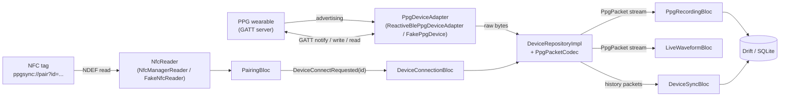
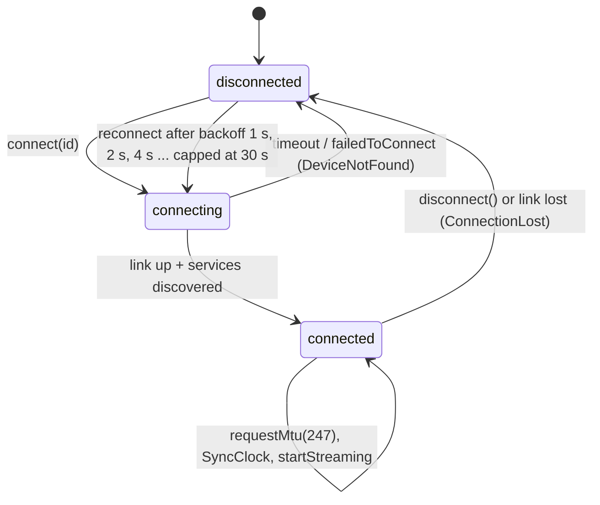
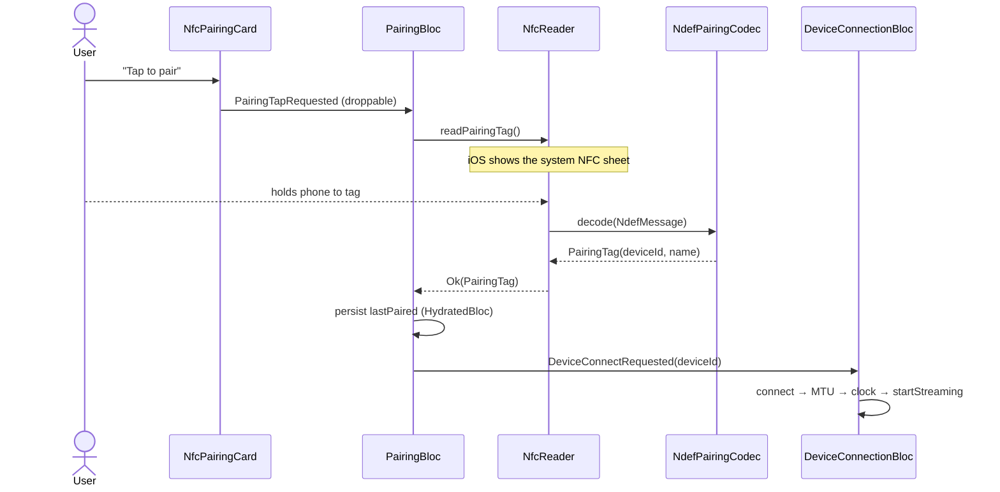

# BLE & NFC primer (with pointers into this repo)

> Everything BLE-specific below the "device adapter" port is a **placeholder protocol**: there is
> no real PPG wearable. `FakePpgDevice` speaks the same bytes as the real adapter would expect,
> and `PpgPacketCodec` is the only class that knows the byte layout.

Contents

1. [The big picture](#1-the-big-picture)
2. [BLE fundamentals](#2-ble-fundamentals)
3. [Our PPG GATT protocol](#3-our-ppg-gatt-protocol)
4. [History download & sequence numbers](#4-history-download--sequence-numbers)
5. [Android vs iOS, permissions](#5-android-vs-ios-permissions)
6. [NFC fundamentals](#6-nfc-fundamentals)
7. [Our NFC pairing tag](#7-our-nfc-pairing-tag)
8. [Code map](#8-code-map)

---

## 1. The big picture



Flow in words: an NFC tap (or a BLE scan) yields a device id → the app connects over BLE, raises the
MTU, sets the device clock and starts streaming → 10 notifications per second each carry 5 PPG samples
→ the codec turns bytes into `PpgPacket`s → packets are drawn live and written to SQLite → after a
disconnect the app asks the device to replay missed sequence numbers from its on-board backlog.

---

## 2. BLE fundamentals

### 2.1 Roles

| Term | Meaning | Here |
|------|---------|------|
| **Peripheral** / GAP peripheral | Advertises, accepts connections | The wearable (`FakePpgDevice` simulates it) |
| **Central** / GAP central | Scans, initiates connections | The phone |
| **GATT server** | Holds the attribute table (services/characteristics) | The wearable |
| **GATT client** | Reads/writes/subscribes to attributes | The phone |

GAP (Generic Access Profile) is about *finding and connecting*; GATT (Generic Attribute Profile) is about
*exchanging data* once connected.

### 2.2 Advertising and scanning

A peripheral broadcasts small advertising packets (31 bytes legacy payload) on three advertising
channels every *advertising interval* (20 ms … 10 s; the fake uses 1 s). They contain flags, the
(local) name, and usually the **service UUIDs** it offers. The central scans and receives these as
`DiscoveredDevice` events with an RSSI (signal strength in dBm; −50 is close, −90 is far).

- **Scan with a service filter.** iOS *requires* a service filter for background scanning, and Android
  throttles apps that start more than 5 scans per 30 s; unfiltered scans also drown in nearby
  headphones and TVs. See `ReactiveBlePpgDeviceAdapter.scan` (`withServices: [serviceUuid]`,
  `ScanMode.lowLatency`, plus a defensive re-filter because some Android stacks deliver results with
  empty `serviceUuids`).
- **Scans must be bounded.** Scanning is the most battery-hungry radio activity; the repository stops
  after a timeout (4 s by default, `DeviceRepositoryImpl.scan`) and sorts results by RSSI.

Code: `lib/features/device_connection/data/adapters/reactive_ble_ppg_device_adapter.dart`,
`lib/features/device_connection/data/fake/fake_ppg_device.dart` (`scan` emits a fake advertisement),
`lib/features/device_connection/domain/entities/ble_types.dart` (`DiscoveredPpgDevice`).

### 2.3 The attribute table: services, characteristics, descriptors

```text
Service 7b5a0001-…  (PPG service, "a folder")
├── Characteristic 7b5a0002-…  PPG data      [notify]
│   └── Descriptor 0x2902 CCCD              (client writes 0x0001 to enable notifications)
├── Characteristic 7b5a0003-…  Control       [write]
└── Characteristic 7b5a0004-…  Status        [read, notify]
    └── Descriptor 0x2902 CCCD
```

- A **service** groups related characteristics and is identified by a UUID (16-bit for SIG-adopted
  services like Battery `0x180F`, 128-bit for custom ones like ours).
- A **characteristic** is one value slot plus **properties** (read, write, write-without-response,
  notify, indicate).
- A **descriptor** is metadata attached to a characteristic. The important one is the **CCCD**
  (Client Characteristic Configuration Descriptor, UUID `0x2902`): writing `0x0001` enables
  notifications, `0x0002` indications. Plugins write it for you when you "subscribe"
  (`subscribeToCharacteristic`).
- After connecting, the client runs **service discovery** to learn the table (handles). The real
  adapter tolerates partial discovery results and only subscribes once the link is `connected`.

Code: UUIDs live only in `PpgPacketCodec` (`serviceUuid`, `ppgCharacteristicUuid`,
`controlCharacteristicUuid`, `statusCharacteristicUuid`) in
`lib/features/device_connection/data/protocol/ppg_packet_codec.dart`.

### 2.4 Notify vs indicate, write with vs without response

| Operation | Ack? | Throughput | Use here |
|-----------|------|------------|----------|
| **Notify** (server → client) | No ATT ack | Many per connection event | PPG data, status |
| **Indicate** (server → client) | Client confirms each value | ~1 per connection event | Not used (too slow for 10 packets/s) |
| **Write with response** (client → server) | Server confirms | Slow, reliable | Control commands |
| **Write without response** (client → server) | No ack | Fast | Not used (commands are rare) |

Notifications are "reliable while the link is up" (the link layer retransmits), but if the link drops
anything in flight is lost — which is why every packet has a **sequence number** and missed ones are
backfilled from the device's backlog (section 4). Commands use write-*with*-response because they are
rare and we want the GATT layer to confirm delivery (`ReactiveBlePpgDeviceAdapter.writeControl`).

### 2.5 MTU and ATT overhead

The **ATT MTU** is the largest ATT packet. It defaults to **23 bytes**; the ATT header takes **3 bytes**
(opcode + handle), leaving **20 bytes** of value per notification. Our data frame is
`14 header + 5 × 3 sample bytes = 29 bytes`, so it does **not** fit in the default MTU.

- After every connect the repository requests MTU **247** (`PpgPacketCodec.preferredMtu`, which allows
  frames up to `247 − 3 = 244` bytes = up to 76 samples). `DeviceRepositoryImpl.connect` does
  `connect → requestMtu(247) → SyncClock`.
- **Android** must call `requestMtu` explicitly (max 517). **iOS** negotiates automatically (typically
  185) and ignores the request; the plugin returns the negotiated value.
- Some stacks silently **truncate** values larger than MTU − 3. The codec rejects any frame whose length
  disagrees with its header (`ProtocolError`), so truncation shows up as an error, not as garbage data.
- `FakePpgDevice` starts at MTU 23 (`defaultMtu`) to make the negotiation step real.

### 2.6 Connection lifecycle



- **flutter_reactive_ble gotcha:** `connectToDevice` returns a stream and **the link only exists while
  that stream has a listener**. The adapter keeps the subscription in a field for the link's lifetime
  and cancels it only in `disconnect()` or when the link is reported lost. A `_generation` counter
  ignores late callbacks from a previous connection attempt.
- Connection supervision timeout: if the peripheral stops answering for a few seconds (walked out of
  range), the stack reports a disconnect. `DeviceConnectionBloc` then retries with **capped
  exponential backoff** (`ReconnectPolicy`: 1 s, ×2, max 30 s, unlimited attempts by default) and
  re-sends `startStreaming` after every (re)connect, because the device stops streaming when the link
  drops. Hammering `connect` would drain battery and on Android can exhaust GATT client slots
  (the infamous status 133).
- Errors from the plugin are mapped to typed failures in `mapBleError`
  (`lib/features/device_connection/domain/ble_failure_mapping.dart`): `DeviceNotFound`,
  `ConnectionLost`, `BluetoothOff`, `BlePermissionDenied`, `ProtocolError`.

Code: `lib/features/device_connection/presentation/bloc/device_connection_bloc.dart`,
`lib/features/device_connection/domain/reconnect_policy.dart`,
`lib/features/device_connection/data/adapters/ble_client.dart` (thin seam over `FlutterReactiveBle`
so the adapter is unit-testable).

---

## 3. Our PPG GATT protocol

Defined entirely in `PpgPacketCodec` (`lib/features/device_connection/data/protocol/ppg_packet_codec.dart`).
All integers are **little-endian** (the BLE convention). Samples are **unsigned 24-bit** (typical PPG
ADC resolution is 18–22 bits).

### 3.1 PPG characteristic (notify) — frames

Three frame types are multiplexed on one characteristic, discriminated by the first byte. One
characteristic keeps ordering guarantees: BLE preserves order *within* a characteristic, but
notifications from two characteristics may interleave.

```text
live    (0x01): [type u8][seq u32][timestampMs u64][n u8][n × sample u24]   (n = 5 → 29 bytes)
history (0x02): same layout as live, replayed from the device backlog
end     (0x03): [type u8][fromSeq u32][toSeq u32][sentCount u32]            (13 bytes)
```

- `seq` is a device-wide, monotonically increasing **sequence number** (one per packet).
- `timestampMs` is the device clock time of the first sample; the app sets the device clock on every
  connect (`SyncClockCommand`) because wearables often boot at epoch 0.
- `HistoryEndFrame` terminates a history answer so the app can tell "done" from "slow".
  `sentCount` may be smaller than requested if the device already overwrote old packets.

### 3.2 Control characteristic (write with response)

```text
0x01                      start streaming live frames
0x02                      stop streaming (device keeps measuring into its backlog)
0x03 [ms u64]             set clock
0x04 [from u32][to u32]   replay history from..to (inclusive), then send an end frame
```

### 3.3 Status characteristic (read + notify)

```text
[battery u8 0..100][flags u8: b0 streaming, b1 charging, b2 hasData][oldestSeq u32][latestSeq u32]
```

`oldestSeq..latestSeq` is the range the device still holds in its backlog — the input for history sync.

### 3.4 Robustness rules

- `decodeFrame` / `decodeStatus` / `decodeCommand` **never throw**: they return
  `Result<…, ProtocolError>` for empty, truncated, oversize, wrong-length or unknown frames. The
  repository counts and skips bad frames (`DeviceRepositoryImpl.protocolErrors`) so one corrupted
  notification can't kill the stream. There is a malformed-input corpus in
  `test/features/device_connection/data/ppg_packet_codec_test.dart`.
- Encoding is only done by code we control (fake device, tests), so invalid values there throw
  `ArgumentError` (a programming error).

### 3.5 Throughput

50 Hz × 3 bytes = 150 B/s of sample data; with headers 10 frames × 29 B = **290 B/s** of ATT values
(~2.3 kbit/s). Even BLE 4.x with one packet per 30 ms connection event moves several kB/s, so the
live stream uses a few percent of the link. History replay is the bursty case: the fake yields every
20 packets to mimic ~1 packet per connection event.

---

## 4. History download & sequence numbers

The wearable stores every packet in a ring buffer **whether or not** a phone is connected
(`FakePpgDevice.backlogCapacity` = 3000 packets = 5 minutes). The phone stores packets in Drift with
primary key `(sessionId, sequence)`.

1. On every link-ready (and when a live sequence gap persists for 1 s, or via the manual button)
   `DeviceSyncBloc` reads the status characteristic → `oldestSeq`, `latestSeq`.
2. `RecordingRepository.missingRanges(sessionId, notBefore: oldestSeq, upTo: latestSeq)` asks SQLite
   which sequence numbers of the **active** session are absent (inner gaps + the tail up to
   `latestSeq`), clipped to what the device still has.
3. Ranges are split into requests of ≤ 300 packets; for each, `DeviceRepository.downloadHistory`
   writes `0x04 [from][to]` and yields history frames until the matching end frame (5 s idle
   timeout → `ProtocolError`; link drop → `ConnectionLost`).
4. Packets are saved in batches of 50; duplicates are ignored by the primary key, so overlap between
   live and history (or a retried range) is harmless.
5. If the link drops mid-download, what was saved stays saved; the next reconnect recomputes the
   missing ranges from the DB and **resumes** where it stopped.

Code: `lib/features/device_sync/presentation/bloc/device_sync_bloc.dart`,
`lib/features/device_connection/data/device_repository_impl.dart` (`downloadHistory`),
`lib/features/ppg_recording/data/drift_recording_repository.dart` (`missingRanges`, `savePackets`).

---

## 5. Android vs iOS, permissions

| Topic | Android | iOS |
|-------|---------|-----|
| Device id | MAC address (`AA:BB:…`), stable | Random per-phone CoreBluetooth UUID; MAC never exposed |
| MTU | App calls `requestMtu` (≤ 517) | Negotiated by the OS (~185); request ignored |
| Scan filter | Recommended (throttling: 5 scan starts / 30 s) | Required for background scanning |
| Runtime permission | Android 12+: `BLUETOOTH_SCAN` (`neverForLocation`) + `BLUETOOTH_CONNECT`; ≤ 11: location | Bluetooth authorization prompt on first use |
| Bluetooth off | Adapter state `poweredOff`; location services off also blocks scans (≤ 11) | `poweredOff`; user must use Control Center |
| GATT quirks | Status 133 on rapid reconnects, one GATT op at a time | Caches GATT tables per device |

Permission declarations (from issue 08):

- `android/app/src/main/AndroidManifest.xml`: `BLUETOOTH_SCAN` with `usesPermissionFlags="neverForLocation"`,
  `BLUETOOTH_CONNECT`, legacy `BLUETOOTH`/`BLUETOOTH_ADMIN` + `ACCESS_FINE_LOCATION`/`ACCESS_COARSE_LOCATION`
  with `maxSdkVersion="30"`, `NFC`, and `uses-feature` for BLE and NFC with `required="false"`.
- `ios/Runner/Info.plist`: `NSBluetoothAlwaysUsageDescription`, `NFCReaderUsageDescription`;
  `ios/Runner/Runner.entitlements`: NFC tag reading (`TAG`). Podfile enables `PERMISSION_BLUETOOTH=1`.

Runtime flow: `PermissionCubit` (`lib/features/device_connection/presentation/cubit/permission_cubit.dart`)
asks `PermissionService` (`permission_handler_service.dart`; Android ≤ 11 also asks location, decided
via `device_info_plus`) and exposes Checking / Granted / Denied / PermanentlyDenied / BluetoothOff;
`PermissionGate` shows the matching UI ("Open settings" when permanently denied). With
`USE_FAKE_DEVICE=true` the `FakePermissionService` grants immediately.

iOS MAC resolution: a MAC from an NFC tag is meaningless on iOS, so
`ReactiveBlePpgDeviceAdapter.connect` scans for the PPG service and picks the advertiser whose name
contains the last two MAC bytes (else the only PPG device in range), caching the mapping.

---

## 6. NFC fundamentals

NFC is 13.56 MHz, ~4 cm range. The phone powers a passive tag through the field and reads its memory.

- **Tag technologies:** ISO 14443 (NFC-A/B, e.g. NTAG213/215/216, MIFARE), ISO 15693 (NFC-V,
  longer range), FeliCa (ISO 18092). `NfcManagerReader` polls ISO 14443 + ISO 15693.
- **NDEF** (NFC Data Exchange Format) is the tag-independent message format: an **NDEF message** is a
  list of **records**. Each record has:
  - **TNF** (Type Name Format, 3 bits) — how to interpret the type: `0x01` *well-known* (NFC Forum RTD
    types such as `U` = URI, `T` = Text), `0x02` MIME media type, `0x03` absolute URI, `0x04`
    external type, …
  - **type** (e.g. `U`), optional **id**, and the **payload**.
- **URI record** payload: `[prefix code][rest]`. The prefix code abbreviates common schemes
  (`0x04` = `https://`); `0x00` = no abbreviation (our custom scheme).
- **Text record** payload: `[status][language code][text]`; status bit 7 = UTF-16, bits 5..0 = length
  of the language code.

Platform differences:

| | Android | iOS |
|-|---------|-----|
| Reading | Foreground dispatch while the app is open; no prompt | `NFCTagReaderSession` shows a system sheet; iPhone 7+ |
| Permission | `android.permission.NFC` (normal, no runtime prompt) | Entitlement `com.apple.developer.nfc.readersession.formats` = `TAG` + `NFCReaderUsageDescription` |
| Accounts | Any | Entitlement requires a **paid** Apple developer account; simulators have no NFC |
| Session | Stays until stopped | Must call `stopSession` (nfc_manager 4.x doesn't auto-close); user can cancel → `NfcReadCancelled` |
| Background tag reading | Intent filter can launch the app | Only for NDEF URLs with universal links (not used) |

---

## 7. Our NFC pairing tag

Format (`NdefPairingCodec`, `lib/features/pairing_nfc/data/ndef_pairing_codec.dart`):

```text
NDEF message
└── record: TNF = 0x01 (well-known), type = "U"
    payload = 0x00 + "ppgsync://pair?id=AA:BB:CC:DD:EE:FF&name=PPG-Sensor"
```

Also accepted: an absolute-URI record (TNF `0x03`) and a Text record containing the URI or just a bare
id. `id` must be a MAC (`XX:XX:XX:XX:XX:XX`) or a CoreBluetooth UUID; the first record that decodes
wins and unrelated records (vendor URL, Android Application Record) are skipped. A URI was chosen
because any NFC writer app can write it and it is human readable.



- `PairingBloc` (`lib/features/pairing_nfc/presentation/bloc/pairing_bloc.dart`) is a `HydratedBloc`
  that persists only the last paired device, so "Reconnect" survives app restarts.
- `FakeNfcReader` (default, `USE_FAKE_NFC=true`) "taps" the fake sensor's tag after 1.5 s by running
  the real codec on an encoded message.
- `NfcManagerReader` maps plugin errors: missing hardware/entitlement → `NfcUnavailable`
  (the UI says "Use Scan below"), user cancel/timeout → `NfcReadCancelled`, bad content →
  `NfcTagInvalid`.

---

## 8. Code map

| Concept | File |
|---------|------|
| GATT UUIDs, byte layout, MTU constants | `lib/features/device_connection/data/protocol/ppg_packet_codec.dart` |
| Radio port (byte level) | `lib/features/device_connection/data/adapters/ppg_device_adapter.dart` |
| Real BLE (flutter_reactive_ble) | `lib/features/device_connection/data/adapters/reactive_ble_ppg_device_adapter.dart`, `ble_client.dart` |
| Simulated wearable + faults | `lib/features/device_connection/data/fake/fake_ppg_device.dart`, `ppg_signal_generator.dart` |
| connect → MTU → clock, history download | `lib/features/device_connection/data/device_repository_impl.dart` |
| Error mapping | `lib/features/device_connection/domain/ble_failure_mapping.dart`, `lib/core/error/failures.dart` |
| Reconnect backoff | `lib/features/device_connection/domain/reconnect_policy.dart`, `presentation/bloc/device_connection_bloc.dart` |
| Permissions | `lib/features/device_connection/domain/permission_service.dart`, `data/permission_handler_service.dart`, `presentation/cubit/permission_cubit.dart` |
| History resync | `lib/features/device_sync/presentation/bloc/device_sync_bloc.dart` |
| NDEF codec | `lib/features/pairing_nfc/data/ndef_pairing_codec.dart` |
| NFC readers | `lib/features/pairing_nfc/data/nfc_manager_reader.dart`, `data/fake/fake_nfc_reader.dart` |
| Platform config | `android/app/src/main/AndroidManifest.xml`, `ios/Runner/Info.plist`, `ios/Runner/Runner.entitlements` |

For the full system (storage, cloud sync, backend) see [ARCHITECTURE.md](ARCHITECTURE.md).
